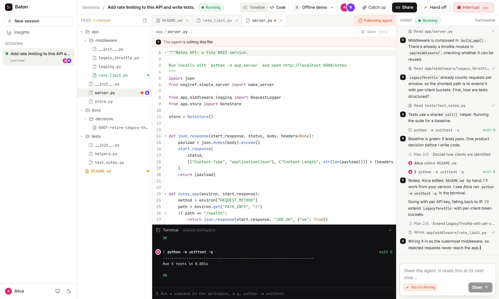

# Baton

**Multiplayer for AI agents.** Baton runs a coding agent on a server instead of in one person's
terminal, and turns its work into a shared, live session. Anyone with the link can watch it work,
catch up in seconds, comment on any step, and steer it. One person drives at a time; handing off is
one click. It works with Claude, Gemini, OpenAI models, or local weights, and you can switch models
mid-session.


## Why

Agents are becoming long-running teammates, but today each one lives in a single person's tab.
Nobody else can see what it's doing, a colleague who knows the codebase can't stop it from going
down the wrong path, and when the person who started it logs off, the work stalls. Baton is the
collaboration layer that sits on top of any agent: an append-only event log that everyone
subscribes to, with roles, hand-offs and a memory of who changed what.

## What's in the box

- **Live shared sessions.** Every token, tool call, diff and test run streams to everyone in the
  session over WebSockets; late joiners replay the log and land on the latest step.
- **Catch-up cards** on join and on hand-off: the goal, what's done, what people changed, the open
  question. Summarized by a cheap model when one is configured, built from the log otherwise.
- **Roles and the baton.** One driver steers, interrupts (Esc) and answers decision points.
  Collaborators suggest or comment on any step; the driver sends the good ones to the agent with
  both names attached. Hand off, ask for the baton, or take it from an absent driver.
- **Presence.** Who's online, who's typing, and which step each person is reading.
- **Scrubber, replay and fork.** Rewind to any step, replay the run, or fork a new branch of the
  work from there (file changes are restored from the log).
- **Code view.** The session's workspace as an IDE: file tree, editor tabs, a shared terminal and the
  agent beside them. Watch the agent's edits land live (changed lines light up) or follow it from file
  to file. See who has which file open. The driver can edit, save and run commands. Hand edits and
  terminal runs are events like everything else: attributed, shown in the timeline, replayed into forks,
  and read by the agent at its next step.
- **Any model, switchable mid-session.** Claude, Gemini, OpenAI, local weights, or any OpenAI/Anthropic
  compatible endpoint, plus an offline demo model.
- **Bring your own agent.** External agents stream into a session and take steering back over a
  small HTTP API.
- **Durable.** SQLite WAL log; kill the server mid-run and sessions resume on restart.
- **Judges on their phones.** Share a link or QR code and anyone joins from a phone: a live status
  strip, one-tap quick prompts, and requests the driver sends to the agent with one tap (the person who
  asked hears when it lands). The driver can **open the floor** so everyone steers the agent directly,
  attributed, while the driver keeps decisions, interrupts and the baton.
- **Hosted in one command.** `deploy/lightsail/launch.sh` puts Baton on an AWS Lightsail server with HTTPS,
  behind a shared access code that invite links and QR codes carry.
- **Insights** across sessions: how and when people intervene, time to first intervention,
  per-model usage. **Audit export** of any session as JSON.

## Run it

Requirements: Python 3.10+. The built web app is committed in `web/dist`, so Node (20.19+ or
22.12+) is only needed if you change the frontend; then run `REBUILD=1 ./run.sh`.

```bash
./run.sh            # creates .venv, builds the web app, starts the server on :8000
```

On Windows, run `.\run.ps1` from PowerShell (`$env:REBUILD="1"; .\run.ps1` to rebuild), or `./run.sh`
from Git Bash. Install [Git for Windows](https://git-scm.com/download/win): agents write POSIX shell
commands (`grep`, `cat`, `a; b`), and Baton runs them with Git's `bash.exe` so they work as written.
Without it, commands fall back to `cmd.exe`. Set `BATON_BASH` to point at a different bash. If your
system Node is too old to build the web app, unzip a newer one into `.tools/node`; both run scripts
pick it up.

Open http://localhost:8000. The server prints a LAN address too; open it on a second laptop (or
scan the QR code in **Share**) to join as a second person. To rehearse alone, open a second
browser profile, or add `?as=Bob` to the URL to give a tab its own identity.

No API keys are needed to try it: the **Offline demo** model is a scripted agent that runs real
tools against the bundled sample repo and reacts to what people say. Add keys to use real models:

```bash
cp .env.example .env    # then fill in ANTHROPIC_API_KEY, GEMINI_API_KEY and/or OPENAI_API_KEY
```

| Provider | How to enable | Notes |
|---|---|---|
| Anthropic (Claude) | `ANTHROPIC_API_KEY` | Messages API with streaming, tool use and prompt caching |
| OpenAI | `OPENAI_API_KEY` | Chat Completions with streaming tool calls |
| Google Gemini | `GEMINI_API_KEY` | Native Gemini API (google-genai): streaming, function calling, thought summaries. With a key set, the menu lists every chat model the key can use. Thought signatures are returned to the model that made them, so Gemini 3 tool loops work, and switching a session to Gemini mid-run works too |
| Local weights | Run Ollama, vLLM, LM Studio or llama.cpp; set `LOCAL_BASE_URL` (default `http://localhost:11434/v1`) | Models are discovered from the server's `/models` endpoint |
| Anything else OpenAI- or Anthropic-compatible | Add it to `providers.json` (see `providers.example.json`) | OpenRouter, Groq, Together, Bedrock gateways, a team GPU box |

For local weights with Ollama: `ollama pull qwen2.5-coder:7b`, then start the server with a context
window big enough for an agent loop, `OLLAMA_CONTEXT_LENGTH=32768 ollama serve`, and pick the model
under **Local** in the model menu. Baton compacts history when it nears `LOCAL_CONTEXT_WINDOW`
(default 32768), so keep the two in step. Small models can be unreliable at tool calling; 7B+ coder
models work best.

### Development

```bash
.venv/bin/pip install -r requirements-dev.txt
.venv/bin/python -m pytest                       # backend: runner, roles, resume, fork, code view, adapters, WebSocket
cd web && npm test                               # frontend: event-log derivation (vitest)
cd web && npm run dev                            # Vite on :5173, proxies /api to :8000
python scripts/e2e_demo.py --out shots           # plays the two-person demo in two real browsers
python scripts/e2e_code.py --out shots           # the code view: edit, save, terminal, presence, follow the agent
python scripts/e2e_mobile.py --out shots         # a judge on a phone: join, request, steer on an open floor
python scripts/e2e_restart.py --out shots        # kills the server mid-run and checks the session resumes
python scripts/e2e_controls.py --out shots       # interrupt, steer, switch model mid-session, fork
python scripts/e2e_demo.py --video rec           # also records both browsers into a side-by-side MP4
```

On Windows the venv's interpreter is `.venv\Scripts\python`. The e2e scripts need
`python -m playwright install chromium` once. `e2e_demo.py`, `e2e_code.py` and `e2e_mobile.py` drive a
server you started (`--url`; pass `--code` to `e2e_mobile.py` if it has an access code); the other two
start their own. AI coding assistants working here should read
[AGENTS.md](AGENTS.md).

## The 3-minute demo

Full runbook with timings, fallbacks and Q&A prep: [docs/DEMO.md](docs/DEMO.md). The pitch deck
lives in the app at `/pitch` and ends on a QR code that opens the live demo. A recording of the
whole flow, Alice's screen on the left and Bob's on the right, is in
[docs/baton-demo.mp4](docs/baton-demo.mp4) (offline demo model, recorded by the browser test).

Two laptops, Alice and Bob. Model: whichever is configured (Offline demo works without network).

1. **Alice starts a session**: "Add rate limiting to this API and write tests." The agent publishes
   a plan and starts exploring `notes-api`. Every token and tool call streams live.
2. **Bob opens the link** on his laptop. A catch-up card tells him the goal, what's done, what's
   next, and that the agent is about to ask a question.
3. **Bob drags the scrubber** back through the timeline, finds the step where the agent read
   `legacy_throttle.py`, and comments: *"This middleware is deprecated (ADR 0007). Don't build on
   it."* Bob isn't driving, so his note goes to Alice, not the agent.
4. **Alice sends Bob's comment to the agent.** The timeline shows the intervention attributed to
   both of them. Once the decision is made, the agent rewrites its plan: a new token-bucket
   middleware instead of extending the legacy one.
5. **Alice hands Bob the baton and leaves.** Bob gets a hand-off card with the open question,
   picks "Per API key", and the agent writes the middleware and tests, runs the suite (11 passing)
   and finishes.
6. *(Optional)* **Kill the server mid-run** and restart it. Both browsers reconnect and the session
   picks up from the log, nothing lost.
7. *(Optional)* **Switch models mid-session** from the header, e.g. start on a local model and hand
   the rest to Claude. The next turn rebuilds context from the shared log for the new model.
8. *(Optional)* **Open the code view** (**Code** in the header). Follow the agent as it writes the
   middleware, then fix a line by hand, save, and run the tests in the terminal. The agent's next
   message acknowledges the edit, and the timeline credits it to whoever made it.

| | |
|---|---|
|  |  |
| Bob comments on a step; Alice gets a notification and sends it to the agent. | Alice hands off; Bob gets the state of play and the open decision. |




## Hosting it

`deploy/lightsail/` has everything to run Baton on AWS Lightsail: one small server with HTTPS (Caddy, with a
free `<ip>.sslip.io` certificate, so no domain needed), Baton behind it as a systemd service, and sessions
kept across deploys and restarts. With the AWS CLI signed in, from Git Bash or any Unix shell:

```bash
./deploy/lightsail/launch.sh     # key pair, instance, static IP, firewall, then the first deploy
./deploy/lightsail/deploy.sh     # later: ship your working copy and restart
```

Hosted Baton requires a shared **access code** (`BATON_ACCESS_CODE`). Entering it once sets a cookie, and
links from **Share** include it, so a judge scanning the QR code lands straight in the session. Locally
there's no code unless you set one. Full guide, costs and security notes:
[deploy/lightsail/README.md](deploy/lightsail/README.md).

## Billing (Stripe)

Baton sells one flat monthly plan per workspace (**Baton Team, $29/month** by default) through Stripe.
Stripe hosts Checkout, where people subscribe, and the customer portal, where they change cards, see
invoices and cancel; card details never touch Baton. While billing is on, Claude, Gemini, OpenAI and local
models need an active subscription. The offline demo model, joining, watching and requesting stay free, so
judges never hit a paywall.

Billing is off until you set a key:

```bash
# .env (or deploy/lightsail/server.env on the server); test keys first
STRIPE_SECRET_KEY=sk_test_...
```

The first **Subscribe** click creates the product and monthly price in your Stripe account (found again by
the lookup key `baton_team_monthly`), and the customer portal gets a default configuration. Then:

- **Pay with a test card:** on the **Billing** page (sidebar), click Subscribe and pay with `4242 4242 4242 4242`,
  any future expiry, any CVC. The page lists Stripe's other test cards (declines, 3D Secure). Coming back from
  Checkout confirms the subscription with Stripe directly, so this works locally without webhooks.
- **Prove it recurs:** `python scripts/stripe_setup.py renewal` subscribes a throwaway customer with
  Stripe's test Visa on a test clock, skips ahead a month and shows the renewal invoice being paid.
- **Webhooks:** keep the status current when people cancel in the portal or a renewal fails. On a server,
  run `python scripts/stripe_setup.py webhook https://your-host` and put the printed `STRIPE_WEBHOOK_SECRET`
  in its settings. Locally, `stripe listen --forward-to localhost:8000/api/billing/webhook` with the Stripe
  CLI does the same. Webhooks are signature-checked, and the subscription is always re-fetched from Stripe.

Settings: `BATON_PLAN_PRICE_CENTS`, `BATON_PLAN_NAME`, `BATON_PLAN_CURRENCY`, `STRIPE_PRICE_ID` (use an
existing price) and `BATON_BILLING_REQUIRED=0` (show billing without locking models). A failed renewal
(`past_due`) keeps the team working while Stripe retries, with a warning on the Billing page.

## The code view

**Code** in the session header switches from the timeline to the workspace itself: the same folder
the agent works in.

| Part | What it does |
|---|---|
| File tree | Added (`A`) and modified (`M`) files, a pulsing dot on the file the agent is working on, and the avatars of teammates who have each file open |
| Editor | CodeMirror with syntax highlighting, search, multiple cursors and per-tab undo. Lines the agent (or anyone) changes light up as they arrive. **Changes** shows the diff against the original repo |
| Follow agent | On by default: the editor opens whatever file the agent is reading or writing. Opening a file yourself turns it off |
| Terminal | Everything that ran in the workspace, by the agent or by people, with output and exit codes. The driver can run commands; **Stop** cancels a long one |
| Agent pane | The live feed, the open decision with its options, and the steer/suggest box, so you can direct the agent without leaving the code |

Only the driver can change files or run commands; everyone else sees a read-only workspace, the same
rule as steering. A save sends the file's fingerprint from when you opened it, and the server refuses
the save if the agent changed the file in the meantime. You then choose **Take theirs** or **Save mine
over it**. Saves and commands go through the same command queue as steering, so each one is a log
event (`human.edit`, `human.command`, `human.command_result`). The agent reads the diff or the output
at its next turn. Forks replay hand edits, catch-up cards list them, insights count them, and a
command that was running when the server died is marked as stopped on restart.

## Bring your own agent

Baton's own runner is one way to drive a session. Any agent that runs elsewhere (a CLI, a CI job,
an in-house loop) can stream its steps into a session and take steering back, through a small
authenticated API. `integrations/baton_client.py` wraps it with the standard library only:

```python
from baton_client import BatonSession

s = BatonSession.create("http://localhost:8000", task="Audit POST /notes", agent="audit-bot")
print("watch at", s.url)               # humans open this, take the baton, comment, steer
s.plan(["Read handler", "Run tests", "Report"])
s.say("Reading the handler.")
call = s.tool("run_command", {"command": "pytest"}); s.result(call, output)
for msg in s.poll():                   # steering, interrupts, hand-offs since last time
    ...
answer = s.ask("400 or 422 for bad input?", ["400", "422"])   # blocks until the driver decides
s.done("Found 3 gaps.")
```

Try it: `python integrations/example_agent.py` prints a session link; open it, take the baton, and
talk to the agent from the browser. Under the hood: `POST /api/external/sessions` returns an ingest
token, `POST /api/sessions/{id}/ingest` appends agent events, and `GET /api/sessions/{id}/inbox`
long-polls for what the humans said.

## How it works

```
 Browser A ─┐                       ┌──────────── Session server ─────────────┐
 Browser B ─┼── WebSocket ─────────▶│ command queue ─▶ runner (tool loop) ──┐ │
 Browser C ─┘  replay from seq N,   │      ▲              │                 │ │
               then live events     │   humans         model adapters      │ │
                                    │ (steer, suggest,  Claude · Gemini ·   │ │
                                    │  hand off, ...)   OpenAI · local …    │ │
                                    │                                       ▼ │
                                    │        append-only event log (SQLite WAL)│
                                    └──────────────────────────────────────────┘
```

* **The log is the product.** Every agent message, tool call, tool result, human message,
  decision and hand-off is an event with a per-session sequence number. Clients replay from any
  seq and then go live, so joining late, reconnecting and scrubbing are the same operation.
* **Context is rebuilt from the log on every turn.** That one choice makes three features fall
  out: resume after a crash, compaction (summaries become `agent.checkpoint` events), and switching
  models mid-session (the next model just reads the same log).
* **Model-agnostic by construction.** Adapters translate one neutral message format to each wire
  protocol: `backend/baton/providers/`. Tool-call ids are normalized so a history written by one
  provider is valid for another.
* **One writer for agent events.** Humans act through a validated command queue; the runner
  injects steering at the next turn boundary, so ordering stays deterministic.
* **Roles.** The driver steers, interrupts, answers decision points and hands off. Collaborators
  suggest and comment; the driver can send any suggestion or comment to the agent. Viewers watch
  and comment. Owners can take the baton from an idle or absent driver.

| Event | Meaning |
|---|---|
| `session.started` / `session.status` / `session.resumed` / `session.forked` | lifecycle |
| `agent.text` / `agent.thinking` | streamed live, persisted when the turn ends |
| `tool.call` / `tool.result` | tool name, input, output, diff, exit code, duration |
| `agent.plan` / `agent.decision_point` / `agent.checkpoint` | plan, a question for humans, compacted summary |
| `human.message` (`steer` or `suggest`) / `human.decision` / `human.interrupt` | every human event carries its author |
| `human.edit` / `human.command` / `human.command_result` | hand edits from the code view (path, full text, diff) and terminal runs (command, output, exit code) |
| `control.driver_requested` / `control.driver_changed` / `control.model_changed` | who's driving, which model |
| `control.open_floor` | the driver let every collaborator steer directly (steers from others carry `open_floor`) |

Layout:

```
backend/baton/       FastAPI app, event store, runner, context builder, sandbox, model adapters
backend/tests/       pytest suite (fake Anthropic/OpenAI servers speak the real wire formats)
web/                 React + Vite + Tailwind single-page app (code view: web/src/session/code/)
sample-repos/        the small repos agents work on in demos
scripts/             browser-driven rehearsals of the demo
```

## Security notes (hackathon scope)

With `BATON_SANDBOX=local` (the default) agent commands, and the driver's terminal commands, run as a
subprocess in the session's workspace with a scrubbed environment. That's fine for a demo on your own
machine. Obviously destructive commands are refused: `sudo`, deleting `/`, `~` or a drive root,
`format`, and piping downloads into a shell. That guard is a seatbelt, not a sandbox. Set
`BATON_SANDBOX=docker` (or `podman`) to run each command in a throwaway container with no network
(pre-pull the image, `python:3.12-slim` by default; this mode is implemented but was not exercised
in our test environment, which has no Docker daemon).
API keys live only on the server; no user credentials reach the agent. Identity is name-only, as
in the plan's hackathon scope: it attributes actions but is not a security boundary. Run Baton on a
network you trust, or set `BATON_ACCESS_CODE` (the Lightsail deploy always does) so the API needs a shared
code; production would put SSO in front of it. External agents authenticate
with a per-session ingest token. The open product question
for production is whose credentials a shared agent should use: a per-session service identity,
the driver's delegated credentials, or org-level bring-your-own-key.

## Where this goes

* Adapters that ingest events from Claude Code, Codex and in-house agents, so Baton is the
  collaboration layer over any agent rather than another agent.
* Durable execution for runs that last days (Temporal or a job queue), Postgres and object storage.
* Org permissions, SSO, audit log export (already a JSON export per session), retention.
* Analytics: where humans intervened, time to intervention, cost per session.
