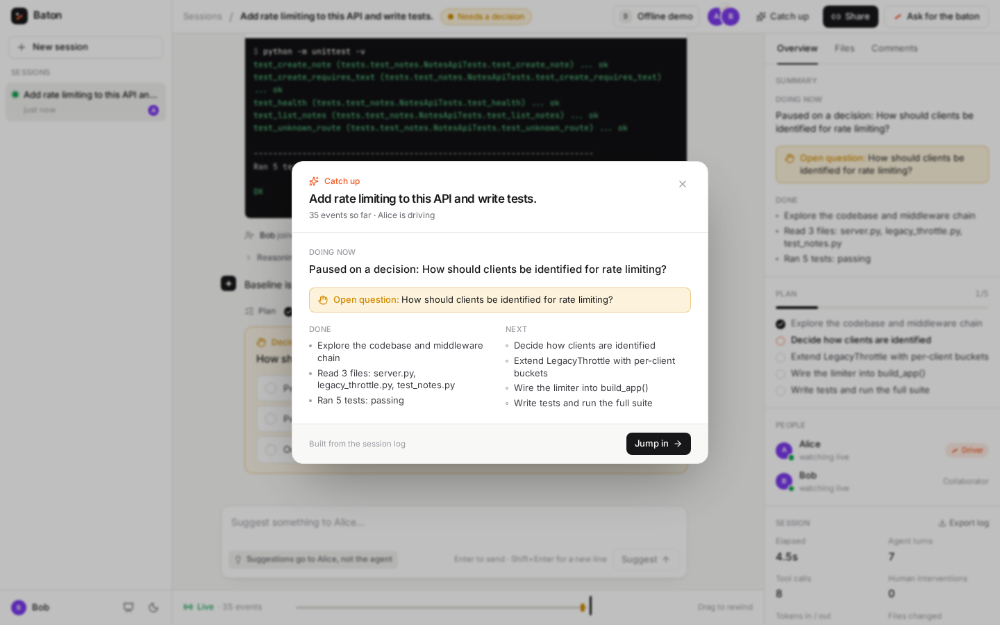
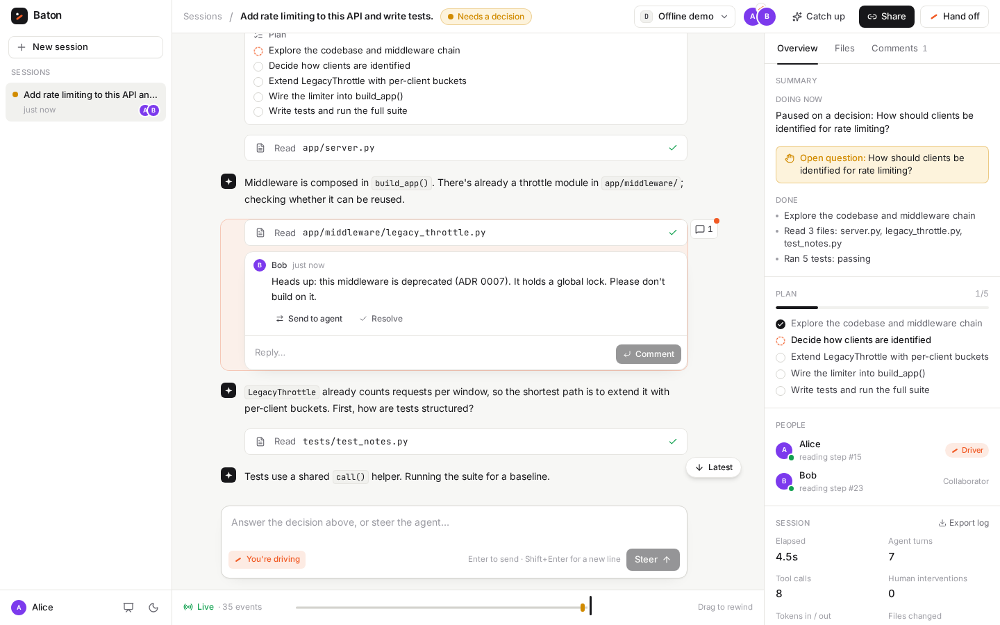
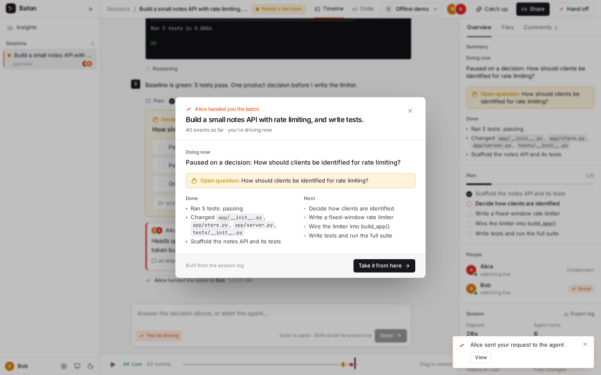
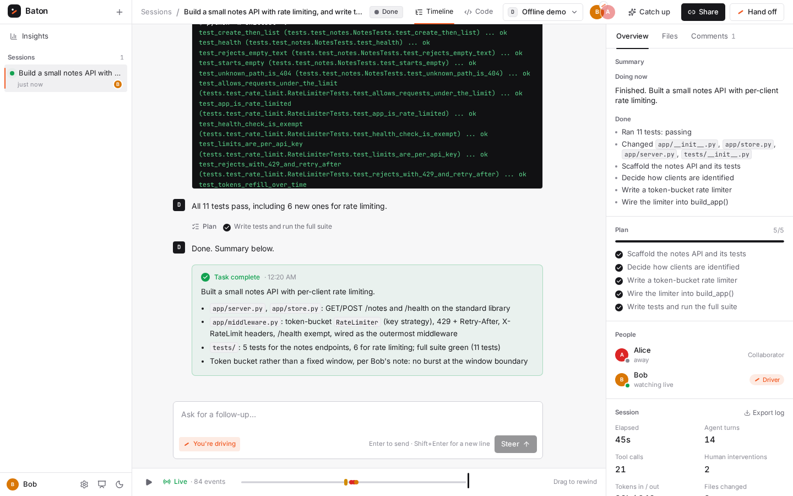

# Baton

**Multiplayer for AI agents.** Baton runs a coding agent on a server instead of in one person's
terminal, and turns its work into a shared, live session. Anyone with the link can watch it work,
catch up in seconds, comment on any step, and steer it. One person drives at a time; handing off is
one click. It works with Claude, OpenAI models, or local weights, and you can switch models
mid-session.



## Why

Agents are becoming long-running teammates, but today each one lives in a single person's tab.
Nobody else can see what it's doing, a colleague who knows the codebase can't stop it from going
down the wrong path, and when the person who started it logs off, the work stalls. Baton is the
collaboration layer that sits on top of any agent: an append-only event log that everyone
subscribes to, with roles, hand-offs and a memory of who changed what.

## What's in the box

- **Live shared sessions.** Every token, tool call, diff and test run streams to everyone in the
  session over WebSockets; late joiners replay the log and land on the latest step.
- **Catch-up cards** on join and on hand-off: the goal, what's done, what people changed, the open
  question. Summarized by a cheap model when one is configured, built from the log otherwise.
- **Roles and the baton.** One driver steers, interrupts (Esc) and answers decision points.
  Collaborators suggest or comment on any step; the driver sends the good ones to the agent with
  both names attached. Hand off, ask for the baton, or take it from an absent driver.
- **Presence.** Who's online, who's typing, and which step each person is reading.
- **Scrubber, replay and fork.** Rewind to any step, replay the run, or fork a new branch of the
  work from there (file changes are restored from the log).
- **Any model, switchable mid-session.** Claude, OpenAI, local weights, or any OpenAI/Anthropic
  compatible endpoint, plus an offline demo model.
- **Bring your own agent.** External agents stream into a session and take steering back over a
  small HTTP API.
- **Durable.** SQLite WAL log; kill the server mid-run and sessions resume on restart.
- **Insights** across sessions: how and when people intervene, time to first intervention,
  per-model usage. **Audit export** of any session as JSON.

## Run it

Requirements: Python 3.10+ and Node 20.19+ (or 22.12+).

```bash
./run.sh            # creates .venv, builds the web app, starts the server on :8000
```

Open http://localhost:8000. The server prints a LAN address too; open it on a second laptop (or
scan the QR code in **Share**) to join as a second person. To rehearse alone, open a second
browser profile, or add `?as=Bob` to the URL to give a tab its own identity.

No API keys are needed to try it: the **Offline demo** model is a scripted agent that runs real
tools against the bundled sample repo and reacts to what people say. Add keys to use real models:

```bash
cp .env.example .env    # then fill in ANTHROPIC_API_KEY and/or OPENAI_API_KEY
```

| Provider | How to enable | Notes |
|---|---|---|
| Anthropic (Claude) | `ANTHROPIC_API_KEY` | Messages API with streaming, tool use and prompt caching |
| OpenAI | `OPENAI_API_KEY` | Chat Completions with streaming tool calls |
| Local weights | Run Ollama, vLLM, LM Studio or llama.cpp; set `LOCAL_BASE_URL` (default `http://localhost:11434/v1`) | Models are discovered from the server's `/models` endpoint |
| Anything else OpenAI- or Anthropic-compatible | Add it to `providers.json` (see `providers.example.json`) | OpenRouter, Groq, Together, Bedrock gateways, a team GPU box |

For local weights with Ollama: `ollama pull qwen2.5-coder:7b && ollama serve`, then pick it under
**Local** in the model menu. Small models can be unreliable at tool calling; 7B+ coder models work
best.

### Development

```bash
.venv/bin/pip install -r requirements-dev.txt
.venv/bin/python -m pytest                       # backend: runner, roles, resume, fork, adapters, WebSocket
cd web && npm test                               # frontend: event-log derivation (vitest)
cd web && npm run dev                            # Vite on :5173, proxies /api to :8000
python scripts/e2e_demo.py --out shots           # plays the two-person demo in two real browsers
python scripts/e2e_restart.py --out shots        # kills the server mid-run and checks the session resumes
python scripts/e2e_controls.py --out shots       # interrupt, steer, switch model mid-session, fork
```

The e2e scripts need `python -m playwright install chromium` once.

## The 3-minute demo

Full runbook with timings, fallbacks and Q&A prep: [docs/DEMO.md](docs/DEMO.md). The pitch deck
lives in the app at `/pitch` and ends on a QR code that opens the live demo.

Two laptops, Alice and Bob. Model: whichever is configured (Offline demo works without network).

1. **Alice starts a session**: "Add rate limiting to this API and write tests." The agent publishes
   a plan and starts exploring `notes-api`. Every token and tool call streams live.
2. **Bob opens the link** on his laptop. A catch-up card tells him the goal, what's done, what's
   next, and that the agent is about to ask a question.
3. **Bob drags the scrubber** back through the timeline, finds the step where the agent read
   `legacy_throttle.py`, and comments: *"This middleware is deprecated (ADR 0007). Don't build on
   it."* Bob isn't driving, so his note goes to Alice, not the agent.
4. **Alice sends Bob's comment to the agent.** The timeline shows the intervention attributed to
   both of them. Once the decision is made, the agent rewrites its plan: a new token-bucket
   middleware instead of extending the legacy one.
5. **Alice hands Bob the baton and leaves.** Bob gets a hand-off card with the open question,
   picks "Per API key", and the agent writes the middleware and tests, runs the suite (11 passing)
   and finishes.
6. *(Optional)* **Kill the server mid-run** and restart it. Both browsers reconnect and the session
   picks up from the log, nothing lost.
7. *(Optional)* **Switch models mid-session** from the header, e.g. start on a local model and hand
   the rest to Claude. The next turn rebuilds context from the shared log for the new model.

| | |
|---|---|
|  |  |
| Bob comments on a step; Alice gets a notification and sends it to the agent. | Alice hands off; Bob gets the state of play and the open decision. |



## Bring your own agent

Baton's own runner is one way to drive a session. Any agent that runs elsewhere (a CLI, a CI job,
an in-house loop) can stream its steps into a session and take steering back, through a small
authenticated API. `integrations/baton_client.py` wraps it with the standard library only:

```python
from baton_client import BatonSession

s = BatonSession.create("http://localhost:8000", task="Audit POST /notes", agent="audit-bot")
print("watch at", s.url)               # humans open this, take the baton, comment, steer
s.plan(["Read handler", "Run tests", "Report"])
s.say("Reading the handler.")
call = s.tool("run_command", {"command": "pytest"}); s.result(call, output)
for msg in s.poll():                   # steering, interrupts, hand-offs since last time
    ...
answer = s.ask("400 or 422 for bad input?", ["400", "422"])   # blocks until the driver decides
s.done("Found 3 gaps.")
```

Try it: `python integrations/example_agent.py` prints a session link; open it, take the baton, and
talk to the agent from the browser. Under the hood: `POST /api/external/sessions` returns an ingest
token, `POST /api/sessions/{id}/ingest` appends agent events, and `GET /api/sessions/{id}/inbox`
long-polls for what the humans said.

## How it works

```
 Browser A ─┐                       ┌──────────── Session server ─────────────┐
 Browser B ─┼── WebSocket ─────────▶│ command queue ─▶ runner (tool loop) ──┐ │
 Browser C ─┘  replay from seq N,   │      ▲              │                 │ │
               then live events     │   humans         model adapters      │ │
                                    │ (steer, suggest,  Claude · OpenAI ·   │ │
                                    │  hand off, ...)   local · offline     │ │
                                    │                                       ▼ │
                                    │        append-only event log (SQLite WAL)│
                                    └──────────────────────────────────────────┘
```

* **The log is the product.** Every agent message, tool call, tool result, human message,
  decision and hand-off is an event with a per-session sequence number. Clients replay from any
  seq and then go live, so joining late, reconnecting and scrubbing are the same operation.
* **Context is rebuilt from the log on every turn.** That one choice makes three features fall
  out: resume after a crash, compaction (summaries become `agent.checkpoint` events), and switching
  models mid-session (the next model just reads the same log).
* **Model-agnostic by construction.** Adapters translate one neutral message format to each wire
  protocol: `backend/baton/providers/`. Tool-call ids are normalized so a history written by one
  provider is valid for another.
* **One writer for agent events.** Humans act through a validated command queue; the runner
  injects steering at the next turn boundary, so ordering stays deterministic.
* **Roles.** The driver steers, interrupts, answers decision points and hands off. Collaborators
  suggest and comment; the driver can send any suggestion or comment to the agent. Viewers watch
  and comment. Owners can take the baton from an idle or absent driver.

| Event | Meaning |
|---|---|
| `session.started` / `session.status` / `session.resumed` / `session.forked` | lifecycle |
| `agent.text` / `agent.thinking` | streamed live, persisted when the turn ends |
| `tool.call` / `tool.result` | tool name, input, output, diff, exit code, duration |
| `agent.plan` / `agent.decision_point` / `agent.checkpoint` | plan, a question for humans, compacted summary |
| `human.message` (`steer` or `suggest`) / `human.decision` / `human.interrupt` | every human event carries its author |
| `control.driver_requested` / `control.driver_changed` / `control.model_changed` | who's driving, which model |

Layout:

```
backend/baton/       FastAPI app, event store, runner, context builder, sandbox, model adapters
backend/tests/       pytest suite (fake Anthropic/OpenAI servers speak the real wire formats)
web/                 React + Vite + Tailwind single-page app
sample-repos/        the small repos agents work on in demos
scripts/             browser-driven rehearsals of the demo
```

## Security notes (hackathon scope)

With `BATON_SANDBOX=local` (the default) agent commands run as a subprocess in the session's
workspace with a scrubbed environment, which is fine for a demo on your own machine. Set
`BATON_SANDBOX=docker` (or `podman`) to run each command in a throwaway container with no network
(pre-pull the image, `python:3.12-slim` by default; this mode is implemented but was not exercised
in our test environment, which has no Docker daemon).
API keys live only on the server; no user credentials reach the agent. The open product question
for production is whose credentials a shared agent should use: a per-session service identity,
the driver's delegated credentials, or org-level bring-your-own-key.

## Where this goes

* Adapters that ingest events from Claude Code, Codex and in-house agents, so Baton is the
  collaboration layer over any agent rather than another agent.
* Durable execution for runs that last days (Temporal or a job queue), Postgres and object storage.
* Org permissions, SSO, audit log export (already a JSON export per session), retention.
* Analytics: where humans intervened, time to intervention, cost per session.
